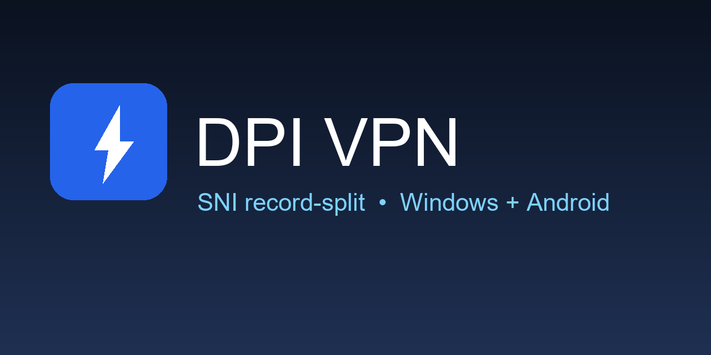
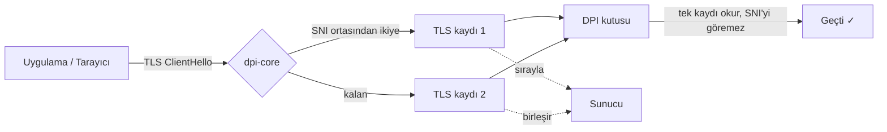

# DPI VPN — Türkiye

[](https://github.com/omerustundag58/dpi-vpn/releases)
[](LICENSE)
[]()

Derin paket incelemesi (DPI) ile uygulanan erişim engellerini aşan,
özgür ve açık kaynaklı VPN. Windows + Android. Kayıt yok, hesap yok.



## Nasıl çalışır?



## Özellikler

- **TLS record-split** — SNI'ı iki TLS kaydına dağıtır; TCP-birleştirmeli
  DPI kutuları engeli göremez (kanıtlı: Discord/Roblox açıldı)
- **8 Türkiye ISS profili** — Türk Telekom, Vodafone, Superonline ve diğerleri
  (zapret-win-turkey stratejilerinden uyarlandı)
- **HTTP CONNECT + düz HTTP proxy** — tarayıcılar doğrudan kullanır
- **IPv6 CONNECT, muaf listesi** (gov.tr/com.tr/google hızlı geçer),
  QUIC engelleme, DNS modu (IPv4+IPv6 Cloudflare)
- **Windows arayüzü** — tema (açık/koyu/sistem), TR/EN, tepsi simgesi,
  canlı log, hız testi, sistem proxy'si, tek `.exe`
- **Android uygulaması** — VpnService (TUN), uygulama bazlı VPN,
  DNS anahtarı, QUIC engelleme, canlı bildirim, Material3
- **WinDivert motoru** (Windows, isteğe bağlı, admin ister)

## Hızlı başlangıç (Windows)

[**Son sürümü indir**](https://github.com/omerustundag58/dpi-vpn/releases/latest)
(`DPI-VPN-Turkiye.exe` — kurulum istemez).

1. BAŞLAT → 2. Firefox HTTPS Proxy: `127.0.0.1:8888` → 3. Sistem Proxy +
   DNS Modu ile Discord/Roblox uygulamaları da geçer.

## Derleme

```sh
# Rust çekirdek + testler
cargo test --workspace

# Windows proxy (release, izsiz)
$env:RUSTFLAGS='--remap-path-prefix=C:\Users\kullanici=~'
cargo build --release -p dpi-proxy

# Windows tek exe (Python 3.x + PyInstaller gerekir)
python -m PyInstaller --noconfirm --clean --onefile --noconsole \
  --name DPI-VPN-Turkiye --add-binary "target/release/dpi-proxy.exe;." zapret-ui/app.py

# Android APK (JDK 17 + cmdline-tools + NDK gerekir, ilk kurulum ~3GB)
cargo build -p dpi-core --target x86_64-linux-android --release
cp target/x86_64-linux-android/release/libdpi_core.so android/app/src/main/jniLibs/x86_64/
cp target/aarch64-linux-android/release/libdpi_core.so android/app/src/main/jniLibs/arm64-v8a/
gradle -p android :app:assembleDebug
```

Android `.so` derlemesi için `.cargo/config.toml.example` dosyasını
`.cargo/config.toml` adıyla kopyalayıp NDK yolunu yazın (yerel dosya,
git'e girmez).

## Yapı

```
dpi-core/    Rust çekirdek: SNI bulma, split/record-split, zapret profilleri (OS bağımsız)
dpi-proxy/   Windows/Linux TCP proxy: CONNECT, düz HTTP, sessiz kip, istatistik
zapret-ui/   Windows arayüzü (tkinter): tema, dil, tepsi, DNS/proxy/QUIC anahtarları
android/     Android uygulaması: VpnService TUN, JNI, Material3, F-Droid metadata
diag.py      DPI tanı scripti: DNS/TCP/bütün/parçalı/proxy probları
docs/        ZAPRET_TURKEY.md (strateji haritası)
share/       Dağıtım paketi (exe + KULLANIM.txt) — sürümle güncellenir
```

## Testler

- `cargo test --workspace` — çekirdek 21 + proxy 6 integration (sahte hedef, CONNECT, IPv6, düz HTTP)
- `python diag.py [host...]` — gerçek ağa karşı kırılma noktası raporu
- Android: cihaz üstünde çekirdek testleri + emülatörde uçtan uca sayfa açılışı (kanıtlı)

## Lisans ve F-Droid

GPL-3.0-or-later (`LICENSE`). Üçüncü taraf notları: `THIRD-PARTY-NOTICES.md`.

F-Droid sürümü yalnızca Rust motorunu içerir (`android/fastlane/` metadata hazır).
`vendor/` (zapret/WinDivert ikilileri) lisansı belirsiz olduğundan depoya
girmez ve F-Droid derlemesine dahil değildir.

## Notlar

- İmzasız `.exe`, Windows SmartScreen uyarısı verir — "Yine de çalıştır" ile geçilir.
- Gerçek uçtan uca şifreleme (WireGuard vb.) sunucu gerektirir; bu sürüm
  DPI atlatma + tünelleme yapar, yol üzerindeki düz trafiği şifrelemez.
